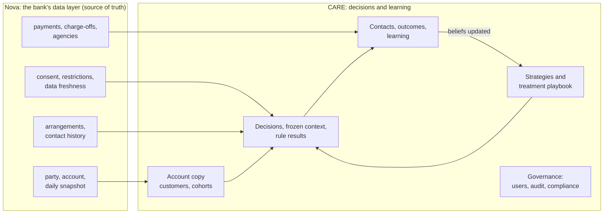
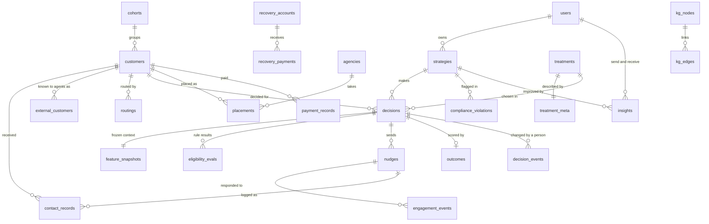
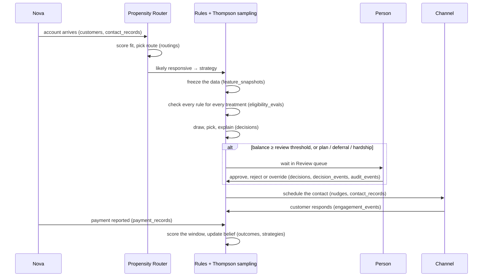

# CARE data schema

How data is organised in CARE (Collection and Recovery Agent): where it comes from, which tables hold
it, how the tables link, and which step of the product writes each one.

This is the overview. Column-level detail is in two companion documents:

| Document | What it holds |
| --- | --- |
| [care-database-schema.md](care-database-schema.md) | CARE's own database: all 30 tables, every column, type and key |
| [nova-data-model.md](nova-data-model.md) | The 11 tables Nova provides, with descriptions and sample rows |
| [nova-recovery-context-schema.md](nova-recovery-context-schema.md) | One account as CARE reads it, field by field |
| [data/](data/) | Sample rows for every Nova table as CSV |

---

## 1. Two layers of data

- **Nova owns what is true about the customer**: who they are, the account, how late it is, consent,
  restrictions, contacts, payments and charge-offs. CARE only reads it.
- **CARE owns what it decides**: strategies, the treatment playbook, every decision with the data it
  was made on, every rule result, every contact, outcome and what was learned, plus the audit trail.
- Today CARE runs on its own SQLite database seeded with synthetic accounts. When Nova is connected,
  the account tables are fed from Nova and everything CARE owns stays as it is.

### Where each Nova table lands

| Nova table | Used by CARE as | CARE table |
| --- | --- | --- |
| `party`, `account`, `account_daily_snapshot` | The delinquent account: balance, days past due, the bank's risk band | `customers`, `cohorts` |
| `contact_consent` | Which channels the customer may be contacted on | Checked by the `CONSENT` and `OPT_OUT` rules, frozen in `feature_snapshots` |
| `restriction` | Hard stops: cease communication, bankruptcy, attorney, deceased, SCRA, dispute, agency placed | Checked by the `RESTRICTION.*` rules |
| `data_freshness` | How old each piece of data is | Checked by the `*_FRESHNESS` rules |
| `arrangement` | Payment plans already in place | Checked by the `ARRANGEMENT` rule |
| `contact_history` | Every contact from every bank system | `contact_records` (feeds the 7-in-7 contact cap) |
| `payment` | Payments received | `payment_records`, then `outcomes` |
| `charge_off` | Charged-off balances for recovery | `recovery_accounts`, `recovery_payments` |
| `agency` | The bank's agency panel | `agencies` |

---

## 2. CARE's tables at a glance

30 tables in five areas.

| Area | Tables | Purpose |
| --- | --- | --- |
| **Accounts** (fed by Nova) | `cohorts`, `customers`, `contact_records`, `external_customers`, `recovery_accounts`, `recovery_payments`, `agencies`, `handoffs` | The accounts CARE acts on, the contacts they already received, and the charged-off book |
| **Strategies and treatments** | `treatments`, `treatment_meta`, `strategies` | What the business allows CARE to do, and the live strategies that use it |
| **Decisions and learning** | `routings`, `decisions`, `feature_snapshots`, `eligibility_evals`, `nudges`, `engagement_events`, `outcomes`, `payment_records`, `decision_events`, `placements` | Every decision, why it was made, what was sent, what happened, and what was learned |
| **Governance and platform** | `users`, `role_permissions`, `audit_events`, `compliance_violations`, `insights`, `alert_rules`, `platform_config` | Who can do what, everything they did, and the settings |
| **Knowledge graph** | `kg_nodes`, `kg_edges` | A graph view of the tables above, rebuilt whenever they change, for the question tools |

### Table by table

| Table | One row is | Key |
| --- | --- | --- |
| `cohorts` | A days-late group: C1 (1–29), C2 (30), C3 (60), C4 (90+ days late) | `cohort_id` |
| `customers` | One delinquent account: balance, arrears, days past due, the bank's risk band, CARE's fit group and route | `customer_id` |
| `contact_records` | One outbound contact, from CARE or the bank's own systems | `contact_id` |
| `external_customers` | The link between an account an agent sent (its `account_id`) and CARE's customer | `link_id` |
| `recovery_accounts` | A charged-off account: charge-off balance, recovered so far, status | `recovery_id` |
| `recovery_payments` | A payment on a recovery account | `payment_id` |
| `agencies` | An external collection agency on the bank's panel | `agency_id` |
| `handoffs` | A batch of new delinquent accounts from the collections system | `handoff_id` |
| `treatments` | A treatment in the playbook (S1 Reminder SMS … S6 Hardship review): offer, channel, cost, track record | `code` |
| `treatment_meta` | A treatment's kind, eligibility rules, approval policy and version | `code` |
| `strategies` | A strategy (e.g. STR-021): audience, allowed treatments, control share, lifecycle state, version | `campaign_id` |
| `routings` | One pass through the Propensity Router: fit group, scores, route | `routing_id` |
| `decisions` | One decision for one account: treatment chosen, selection probability, review state, explanation | `decision_id` |
| `feature_snapshots` | The exact data a decision was made on. Write-once | `snapshot_id` |
| `eligibility_evals` | One rule checked for one candidate treatment of one decision. Write-once | `eval_id` |
| `nudges` | A contact CARE scheduled: channel, message, status | `nudge_id` |
| `engagement_events` | A response to a contact: opened, clicked, replied, opted out | `event_id` |
| `outcomes` | What happened in the evaluation window: paid, amount, reward, learned | `outcome_id` |
| `payment_records` | One payment reported against a decision | `record_id` |
| `decision_events` | A change a person made to an agent's decision (approve, reject, override, cancel) | `event_id` |
| `placements` | An account proposed to, or placed with, an agency | `placement_id` |
| `users` | A console user and their role | `user_id` |
| `role_permissions` | One permission granted or denied to one role | `role`, `permission` |
| `audit_events` | One action: who, what, on which record, when | `audit_id` |
| `compliance_violations` | A breach the compliance monitor found, and its resolution | `violation_id` |
| `insights` | A recommendation an executive sends to a strategy analyst | `insight_id` |
| `alert_rules` | A threshold that raises an alert | `rule_id` |
| `platform_config` | A setting an admin can change (contact cap, review threshold, …) | `key` |
| `kg_nodes` | A node in the knowledge graph (customer, strategy, treatment, decision, …) | `node_id` |
| `kg_edges` | A typed link between two nodes | `edge_id` |

> Two names to know: the `treatments` table is the class `models.Strategy` in code, and the
> `strategies` table is the class `Campaign`. The tables were renamed to match the screens; the
> classes kept their old names.

---

## 3. How the tables link

Every link is a declared foreign key, enforced on SQLite too and checked when the transaction commits.

### Full list of foreign keys

| From | To | Notes |
| --- | --- | --- |
| `customers.cohort_id` | `cohorts.cohort_id` | |
| `contact_records.customer_id` | `customers.customer_id` | |
| `contact_records.nudge_id` | `nudges.nudge_id` | Empty for the bank's own contacts |
| `external_customers.customer_id` | `customers.customer_id` | |
| `recovery_payments.recovery_id` | `recovery_accounts.recovery_id` | |
| `treatment_meta.code` | `treatments.code` | |
| `strategies.owner_id` | `users.user_id` | |
| `strategies.escalate_to` | `treatments.code` | Set to empty if the treatment is removed |
| `routings.customer_id` | `customers.customer_id` | |
| `decisions.campaign_id` | `strategies.campaign_id` | |
| `decisions.customer_id` | `customers.customer_id` | |
| `decisions.treatment_code` | `treatments.code` | |
| `decisions.original_treatment` | `treatments.code` | What the engine chose before a person overrode it |
| `feature_snapshots.decision_id` | `decisions.decision_id` | |
| `eligibility_evals.decision_id` | `decisions.decision_id` | |
| `eligibility_evals.arm_id` | `treatments.code` | |
| `nudges.decision_id`, `.campaign_id`, `.customer_id`, `.treatment_code` | `decisions`, `strategies`, `customers`, `treatments` | |
| `engagement_events.nudge_id`, `.customer_id` | `nudges`, `customers` | |
| `outcomes.decision_id`, `.campaign_id`, `.customer_id` | `decisions`, `strategies`, `customers` | |
| `payment_records.customer_id` | `customers.customer_id` | |
| `decision_events.decision_id` | `decisions.decision_id` | |
| `placements.customer_id`, `.agency_id` | `customers`, `agencies` | |
| `compliance_violations.campaign_id`, `.customer_id`, `.nudge_id` | `strategies`, `customers`, `nudges` | `campaign_id` set to empty if the strategy is removed |
| `insights.campaign_id`, `.from_user`, `.to_user` | `strategies`, `users`, `users` | `campaign_id` set to empty if the strategy is removed |
| `kg_edges.src`, `.dst` | `kg_nodes.node_id` | |

---

## 4. Which step writes which table

The life of one account, and the rows it leaves behind.

| Step | Writes |
| --- | --- |
| Accounts arrive | `handoffs`, `customers`, `contact_records`; `external_customers` when an agent sends the account |
| Propensity Router | `routings`, and `customers.route` |
| Decision | `feature_snapshots`, `eligibility_evals`, `decisions` |
| Review by a person | `decisions` (review fields), `decision_events`, `audit_events` |
| Contact | `nudges`, `contact_records` |
| Response | `engagement_events` |
| Payment | `payment_records`, then `outcomes` at the end of the window |
| Learning | `outcomes.learned`, and the strategy's beliefs |
| Recovery | `recovery_accounts`, `recovery_payments` |
| Agency placement | `placements`, `audit_events` |
| Any console or agent action | `audit_events` |
| Any table change | `kg_nodes`, `kg_edges` (rebuilt) |

---

## 5. Values that recur

### Days-late groups (`cohorts.cohort_id`)

| Code | Group |
| --- | --- |
| C1 | 1–29 days late |
| C2 | 30 days late |
| C3 | 60 days late |
| C4 | 90+ days late |

Accounts that are charged off, or 180 or more days past due, move to recovery (`recovery_accounts`).

### Fit groups and routes (`customers.segment`, `customers.route`)

| Fit group (screen) | Stored `segment` | Route | What happens |
| --- | --- | --- | --- |
| Likely responsive | `Persuadable` | `strategy` | Enters a live strategy |
| Likely self-cure | `Sure Thing` | `bau` | Stays on business as usual |
| Needs support | `Lost Cause` | `hardship` | Goes to the hardship team |
| Do not contact | `Sleeping Dog` | `suppress` | Not contacted |

A small validation share (5% by default, at most 10%) is sent against its route so the router can be
scored. Do not contact is never included.

### Treatments (`treatments.code`)

| Code | Treatment | Channel | Needs a person |
| --- | --- | --- | --- |
| S1 | Reminder SMS | SMS | Only above the review threshold |
| S2 | In-app nudge | App push | Only above the review threshold |
| S3 | Split payment plan | SMS + App | Always |
| S4 | Payment deferral | SMS + App | Always |
| S5 | Agent call | Outbound call | Only above the review threshold |
| S6 | Hardship review | Specialist team | Always |
| R1 | Settlement offer (recovery): 60% of what remains | Letter and SMS | Always (settlement review) |
| R2 | One-time payment (recovery) | SMS and email with a payment link | No |
| R3 | Human review (recovery) | Specialist phone call | A specialist handles it; the only option at $25,000 or more remaining |

### Strategy lifecycle (`strategies.status`)

`Draft` → `In review` → `Approved` → `Live` ⇄ `Paused` → `Archived`

A strategy that has run is never edited in place. Editing creates the next version as a new draft
with its own control group.

### Rule stages (`eligibility_evals.stage`)

| Stage | Rules |
| --- | --- |
| `playbook` | `ACTIVE`: the treatment is active in the playbook |
| `business` | `RULES`: the treatment's own eligibility rules |
| `hard_stop` | `VULNERABILITY`, `RESTRICTION.*` (cease communication, bankruptcy, attorney represented, deceased, SCRA protected, dispute pending, agency placed), `RESTRICTIONS_FRESHNESS` |
| `context` | `ARRANGEMENT`: a payment plan already in place |
| `contact` | `CONSENT`, `OPT_OUT`, `CONTACT_CAP` (7 in 7 days), `CALL_CAP` |

Each row stores `result` (`PASS` or `BLOCK`), a `reason_code`, a plain reason and the inputs it read.

---

## 6. Conventions

- **Keys.** Every link is a declared foreign key, deferred to commit, enforced on SQLite
  (`PRAGMA foreign_keys = ON`) and on Postgres.
- **Times.** `TIMESTAMP WITH TIME ZONE` and `DATE` on Postgres. On SQLite, canonical ISO 8601 text in
  UTC. Invalid values are refused on write.
- **Write-once records.** `feature_snapshots` and `eligibility_evals` are never updated: they are the
  evidence for a decision.
- **Nothing with history is deleted.** Strategies are archived and treatments retired.
- **Customer names stay inside CARE.** Agents, traces and logs get the account number or a token,
  never a name. Inbound customer data is encrypted before it is stored.
- **Upgrades in place.** On start-up, `app/core/migrate.py` renames old tables and rebuilds any table
  whose keys are missing, keeping every row. A second run changes nothing.
- **Databases.** SQLite locally. Set `DATABASE_URL` for Postgres.
