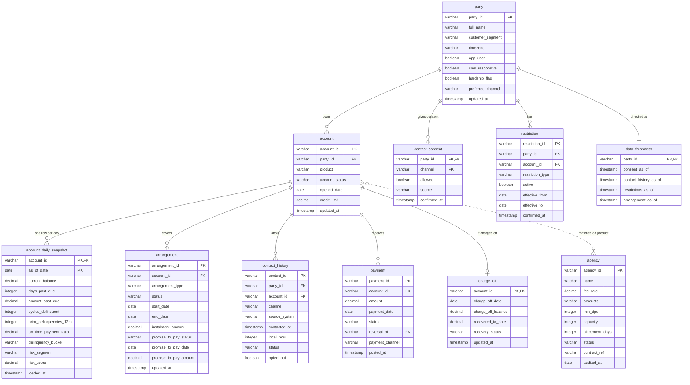

# Nova data model for the Recovery Agent

As of 6 November 2026.

## How it fits

Nova is the Recovery Agent's data source, and that is its only role. The agent reads customer and account data from Nova and keeps its own decisions, strategies and results to itself.

The agent needs 11 tables from Nova: party, account, the daily account snapshot, contact consent, restrictions, data freshness, arrangements, contact history, payments, charge-offs and agencies. Nova's own source systems load them, and the agent only reads them.

Each table below has a column list with descriptions, followed by sample rows. The same sample rows are in [`docs/data/`](data/) as one CSV per table, with the column descriptions in [`data_dictionary.csv`](data/data_dictionary.csv). The samples use one running example, Whitney Callahan, account `A-90031`, so the keys join up across tables. All names and numbers are fictional.

## ER diagram

There are two hubs. `party` holds the customer-level tables: consent, restrictions and data freshness. `account` holds the account-level tables: the daily snapshot, arrangements, contact history, payments and charge-offs. Agencies are matched to accounts by product, not by key.

## Customer and account

### party

One row per customer. It holds the customer's name and the behaviour signals the agent uses to judge which channel fits. Sample: [`data/party.csv`](data/party.csv).

| Column | Type | Key | Required | Description |
| --- | --- | --- | --- | --- |
| `party_id` | VARCHAR(64) | PK | yes | Nova's customer id. Every other customer-level table joins on it |
| `full_name` | VARCHAR(60) |  | no | Used only to greet the customer in a message |
| `customer_segment` | VARCHAR(40) |  | no | The bank's own segment. Stored, not used to decide |
| `timezone` | VARCHAR(40) |  | yes | IANA name, e.g. America/Chicago. Send times and quiet hours use it |
| `app_user` | BOOLEAN |  | yes | Active mobile-app user in the last 90 days |
| `sms_responsive` | BOOLEAN |  | yes | Has replied to or tapped an SMS before |
| `hardship_flag` | BOOLEAN |  | yes | A hardship indicator is on file. Opens hardship treatments |
| `preferred_channel` | VARCHAR(10) |  | no | App, SMS, Email or Phone, as the customer stated it |
| `updated_at` | TIMESTAMP |  | yes | When these values were last confirmed |

| party_id | full_name | customer_segment | timezone | app_user | sms_responsive | hardship_flag | preferred_channel | updated_at |
| --- | --- | --- | --- | --- | --- | --- | --- | --- |
| P-55210 | Whitney Callahan | Mass market | America/Chicago | true | true | false | SMS | 2026-11-06T05:40:00Z |
| P-55211 | Derek Ostrowski | Small business | America/New_York | false | false | true | Phone | 2026-11-06T05:40:00Z |
| P-55212 | Marisol Vega | Mass market | America/Denver | true | false | false | App | 2026-11-06T05:40:00Z |
| P-55213 | Gordon Pike | Affluent | America/Los_Angeles | false | true | false | Email | 2026-11-06T05:40:00Z |

### account

One row per card account: the attributes that rarely change. Balances and arrears move daily, so they sit in account_daily_snapshot. Sample: [`data/account.csv`](data/account.csv).

| Column | Type | Key | Required | Description |
| --- | --- | --- | --- | --- |
| `account_id` | VARCHAR(64) | PK | yes | Nova's account id. The key for every decision the agent makes |
| `party_id` | VARCHAR(64) | FK → party | yes | The customer who owns the account |
| `product` | VARCHAR(20) |  | yes | Consumer Credit Card, Small Business Card, Retail Card or Co-Brand Card. Decides which strategies and agencies apply |
| `account_status` | VARCHAR(20) |  | yes | Open, Closed or Charged off |
| `opened_date` | DATE |  | yes | Gives tenure |
| `credit_limit` | DECIMAL(12,2) |  | yes | Gives utilisation |
| `updated_at` | TIMESTAMP |  | yes | When the row last changed |

| account_id | party_id | product | account_status | opened_date | credit_limit | updated_at |
| --- | --- | --- | --- | --- | --- | --- |
| A-90031 | P-55210 | Consumer Credit Card | Open | 2019-03-12 | 4000.00 | 2026-11-06T05:40:00Z |
| A-90032 | P-55211 | Small Business Card | Open | 2016-08-01 | 15000.00 | 2026-11-06T05:40:00Z |
| A-90033 | P-55212 | Retail Card | Open | 2023-01-20 | 1500.00 | 2026-11-06T05:40:00Z |
| A-90034 | P-55213 | Co-Brand Card | Charged off | 2014-05-30 | 9000.00 | 2026-09-02T08:00:00Z |

### account_daily_snapshot

One row per account per day: balance, arrears and the bank's risk view as they stood that day. The agent decides on the latest row and keeps the date it used, so a decision can be replayed. Sample: [`data/account_daily_snapshot.csv`](data/account_daily_snapshot.csv).

| Column | Type | Key | Required | Description |
| --- | --- | --- | --- | --- |
| `account_id` | VARCHAR(64) | PK, FK → account | yes | The account |
| `as_of_date` | DATE | PK | yes | The day these values were true |
| `current_balance` | DECIMAL(12,2) |  | yes | Outstanding balance |
| `days_past_due` | INTEGER |  | yes | 0-720. Routes the account to a days-late group and strategy |
| `amount_past_due` | DECIMAL(12,2) |  | yes | Arrears amount. Quoted in messages |
| `cycles_delinquent` | INTEGER |  | no | Billing cycles behind |
| `prior_delinquencies_12m` | INTEGER |  | yes | Missed payments in the last 12 months, 0-12 |
| `on_time_payment_ratio` | DECIMAL(4,3) |  | yes | Share of the last 12 months' payments made on time, 0-1 |
| `delinquency_bucket` | VARCHAR(20) |  | no | The bank's own bucket label. Stored only |
| `risk_segment` | VARCHAR(10) |  | yes | The bank's risk band: Low, Medium, High or Very high. Never recomputed |
| `risk_score` | DECIMAL(5,2) |  | no | The bank's score, 0-100, higher is riskier. Stored only |
| `loaded_at` | TIMESTAMP |  | yes | When Nova loaded the row |

| account_id | as_of_date | current_balance | days_past_due | amount_past_due | cycles_delinquent | prior_delinquencies_12m | on_time_payment_ratio | delinquency_bucket | risk_segment | risk_score | loaded_at |
| --- | --- | --- | --- | --- | --- | --- | --- | --- | --- | --- | --- |
| A-90031 | 2026-11-06 | 2840.15 | 34 | 165.00 | 2 | 2 | 0.830 | 30-59 | Medium | 52.0 | 2026-11-06T05:40:00Z |
| A-90031 | 2026-11-05 | 2840.15 | 33 | 165.00 | 2 | 2 | 0.830 | 30-59 | Medium | 51.5 | 2026-11-05T05:40:00Z |
| A-90032 | 2026-11-06 | 11204.80 | 68 | 1310.00 | 3 | 4 | 0.580 | 60-89 | High | 74.0 | 2026-11-06T05:40:00Z |
| A-90033 | 2026-11-06 | 612.40 | 12 | 35.00 | 1 | 0 | 0.950 | 1-29 | Low | 21.0 | 2026-11-06T05:40:00Z |

## Consent, restrictions and arrangements

### contact_consent

One row per customer per channel. App push and letters need no consent row. Sample: [`data/contact_consent.csv`](data/contact_consent.csv).

| Column | Type | Key | Required | Description |
| --- | --- | --- | --- | --- |
| `party_id` | VARCHAR(64) | PK, FK → party | yes | The customer |
| `channel` | VARCHAR(10) | PK | yes | SMS, EMAIL or CALL |
| `allowed` | BOOLEAN |  | yes | false blocks every treatment on that channel. SMS also covers SMS + App |
| `source` | VARCHAR(30) |  | no | Where the customer gave or withdrew consent, e.g. Online banking, Call centre |
| `confirmed_at` | TIMESTAMP |  | yes | When Nova last confirmed the value |

| party_id | channel | allowed | source | confirmed_at |
| --- | --- | --- | --- | --- |
| P-55210 | SMS | true | Online banking | 2026-11-06T05:40:00Z |
| P-55210 | EMAIL | true | Online banking | 2026-11-06T05:40:00Z |
| P-55210 | CALL | false | Call centre | 2026-11-06T05:40:00Z |
| P-55211 | CALL | true | Branch | 2026-11-06T05:40:00Z |

### restriction

One row per restriction on file. Any active row stops all automated treatment for the customer, or for the one account when account_id is set. Sample: [`data/restriction.csv`](data/restriction.csv).

| Column | Type | Key | Required | Description |
| --- | --- | --- | --- | --- |
| `restriction_id` | VARCHAR(64) | PK | yes | Nova's id for the restriction |
| `party_id` | VARCHAR(64) | FK → party | yes | The customer |
| `account_id` | VARCHAR(64) | FK → account | no | Set when the restriction covers one account only |
| `restriction_type` | VARCHAR(30) |  | yes | VULNERABLE, CEASE_COMMUNICATION, BANKRUPTCY, ATTORNEY_REPRESENTED, DECEASED, SCRA_PROTECTED, DISPUTE_PENDING or AGENCY_PLACED. VULNERABLE sends the customer to a person |
| `active` | BOOLEAN |  | yes | Only active rows stop treatment |
| `effective_from` | DATE |  | yes | When it started |
| `effective_to` | DATE |  | no | When it ended, if it has |
| `confirmed_at` | TIMESTAMP |  | yes | When Nova last confirmed the row |

| restriction_id | party_id | account_id | restriction_type | active | effective_from | effective_to | confirmed_at |
| --- | --- | --- | --- | --- | --- | --- | --- |
| R-7001 | P-55211 | A-90032 | DISPUTE_PENDING | true | 2026-10-28 |  | 2026-11-06T05:40:00Z |
| R-6920 | P-55213 |  | ATTORNEY_REPRESENTED | false | 2025-02-10 | 2025-09-30 | 2026-11-06T05:40:00Z |

### data_freshness

One row per customer: when each guardrail area was last checked. No restriction rows can mean "checked, none" or "never checked"; only this table tells the two apart. Consent, contact history or restrictions older than 24 hours, or missing, make the agent fail closed (24 hours is a placeholder until compliance approves a limit). Sample: [`data/data_freshness.csv`](data/data_freshness.csv).

| Column | Type | Key | Required | Description |
| --- | --- | --- | --- | --- |
| `party_id` | VARCHAR(64) | PK, FK → party | yes | The customer |
| `consent_as_of` | TIMESTAMP |  | yes | When contact_consent was last refreshed |
| `contact_history_as_of` | TIMESTAMP |  | yes | When contact_history was last complete |
| `restrictions_as_of` | TIMESTAMP |  | yes | When restriction was last checked, including "none found" |
| `arrangement_as_of` | TIMESTAMP |  | no | When arrangement was last refreshed. Logged only |

| party_id | consent_as_of | contact_history_as_of | restrictions_as_of | arrangement_as_of |
| --- | --- | --- | --- | --- |
| P-55210 | 2026-11-06T05:40:00Z | 2026-11-06T05:40:00Z | 2026-11-06T05:40:00Z | 2026-11-06T05:40:00Z |
| P-55211 | 2026-11-06T05:40:00Z | 2026-11-06T05:40:00Z | 2026-11-06T05:40:00Z | 2026-11-05T22:10:00Z |

### arrangement

One row per payment plan, deferral, settlement or promise to pay. The agent reads it before offering a new plan or deferral. Sample: [`data/arrangement.csv`](data/arrangement.csv).

| Column | Type | Key | Required | Description |
| --- | --- | --- | --- | --- |
| `arrangement_id` | VARCHAR(64) | PK | yes | Nova's id for the arrangement |
| `account_id` | VARCHAR(64) | FK → account | yes | The account it covers |
| `arrangement_type` | VARCHAR(20) |  | yes | PAYMENT_PLAN, DEFERRAL, SETTLEMENT or PROMISE_TO_PAY |
| `status` | VARCHAR(12) |  | yes | ACTIVE, COMPLETED, BROKEN or CANCELLED |
| `start_date` | DATE |  | yes | First day in force |
| `end_date` | DATE |  | no | Last day in force |
| `instalment_amount` | DECIMAL(12,2) |  | no | Amount per instalment, for plans |
| `promise_to_pay_status` | VARCHAR(10) |  | no | NONE, PENDING, KEPT or BROKEN |
| `promise_to_pay_date` | DATE |  | no | Date the customer promised to pay |
| `promise_to_pay_amount` | DECIMAL(12,2) |  | no | Amount promised |
| `updated_at` | TIMESTAMP |  | yes | When the row last changed |

| arrangement_id | account_id | arrangement_type | status | start_date | end_date | instalment_amount | promise_to_pay_status | promise_to_pay_date | promise_to_pay_amount | updated_at |
| --- | --- | --- | --- | --- | --- | --- | --- | --- | --- | --- |
| AR-3301 | A-90032 | PAYMENT_PLAN | ACTIVE | 2026-10-15 | 2027-01-15 | 437.00 | NONE |  |  | 2026-11-05T22:10:00Z |
| AR-3288 | A-90033 | PROMISE_TO_PAY | ACTIVE | 2026-11-04 | 2026-11-12 |  | PENDING | 2026-11-12 | 35.00 | 2026-11-04T14:02:00Z |

## Contacts, payments, charge-offs and agencies

### contact_history

One row per outbound contact the customer received, from every system: the bank's dialler, letters, agencies and digital channels. The 7-contacts-in-7-days cap is about what the customer experienced, so every source counts. Sample: [`data/contact_history.csv`](data/contact_history.csv).

| Column | Type | Key | Required | Description |
| --- | --- | --- | --- | --- |
| `contact_id` | VARCHAR(64) | PK | yes | Nova's id for the contact |
| `party_id` | VARCHAR(64) | FK → party | yes | The customer contacted |
| `account_id` | VARCHAR(64) | FK → account | no | The account it was about |
| `channel` | VARCHAR(12) |  | yes | SMS, EMAIL, CALL, APP_PUSH, LETTER or VISIT |
| `source_system` | VARCHAR(30) |  | yes | Who made it, e.g. BAU_DIALLER, LETTER_SERVICE, AGENCY, DIGITAL |
| `contacted_at` | TIMESTAMP |  | yes | When it was sent (UTC) |
| `local_hour` | INTEGER |  | yes | Hour in the customer's time zone, 0-23. Checked against permitted contact hours |
| `status` | VARCHAR(12) |  | yes | SENT, DELIVERED or FAILED |
| `opted_out` | BOOLEAN |  | yes | The customer opted out in response. Opt-outs are permanent |

| contact_id | party_id | account_id | channel | source_system | contacted_at | local_hour | status | opted_out |
| --- | --- | --- | --- | --- | --- | --- | --- | --- |
| C-118203 | P-55210 | A-90031 | SMS | BAU_DIALLER | 2026-11-03T15:00:00Z | 9 | DELIVERED | false |
| C-118290 | P-55210 | A-90031 | LETTER | LETTER_SERVICE | 2026-11-04T08:00:00Z | 2 | SENT | false |
| C-118377 | P-55211 | A-90032 | CALL | BAU_DIALLER | 2026-11-04T18:30:00Z | 13 | DELIVERED | false |

### payment

One row per payment, including payments after charge-off. The agent works out each decision's outcome from these: the total of the posted payments inside the strategy's evaluation window. Sample: [`data/payment.csv`](data/payment.csv).

| Column | Type | Key | Required | Description |
| --- | --- | --- | --- | --- |
| `payment_id` | VARCHAR(64) | PK | yes | Nova's payment id. Each id counts once |
| `account_id` | VARCHAR(64) | FK → account | yes | The account paid |
| `amount` | DECIMAL(12,2) |  | yes | Amount paid |
| `payment_date` | DATE |  | yes | Date paid. Decides whether it fell inside the window |
| `status` | VARCHAR(10) |  | yes | POSTED or REVERSED. A reversed payment counts as not paid |
| `reversal_of` | VARCHAR(64) | FK → payment | no | For a reversal, the payment it reverses |
| `payment_channel` | VARCHAR(20) |  | no | Online, App, Branch, Phone or Agency |
| `posted_at` | TIMESTAMP |  | yes | When the payment posted in Nova |

| payment_id | account_id | amount | payment_date | status | reversal_of | payment_channel | posted_at |
| --- | --- | --- | --- | --- | --- | --- | --- |
| PAY-551902 | A-90031 | 100.00 | 2026-11-08 | POSTED |  | App | 2026-11-08T19:12:00Z |
| PAY-551977 | A-90031 | 65.00 | 2026-11-10 | POSTED |  | App | 2026-11-10T12:40:00Z |
| PAY-552010 | A-90033 | 35.00 | 2026-11-09 | REVERSED |  | Online | 2026-11-11T06:00:00Z |
| PAY-561200 | A-90034 | 250.00 | 2026-10-21 | POSTED |  | Agency | 2026-10-22T06:00:00Z |

### charge_off

One row per charged-off account in recovery. Recovery accounts are tracked by what remains of the charged-off balance, not by days past due. Sample: [`data/charge_off.csv`](data/charge_off.csv).

| Column | Type | Key | Required | Description |
| --- | --- | --- | --- | --- |
| `account_id` | VARCHAR(64) | PK, FK → account | yes | The charged-off account |
| `charge_off_date` | DATE |  | yes | When it was charged off |
| `charge_off_balance` | DECIMAL(12,2) |  | yes | Balance at charge-off |
| `recovered_to_date` | DECIMAL(12,2) |  | yes | Total recovered since charge-off |
| `recovery_status` | VARCHAR(24) |  | yes | Active Recovery, Partial Recovery, Payment Plan, Settlement Agreement or Paid in Full |
| `updated_at` | TIMESTAMP |  | yes | When the row last changed |

| account_id | charge_off_date | charge_off_balance | recovered_to_date | recovery_status | updated_at |
| --- | --- | --- | --- | --- | --- |
| A-90034 | 2026-09-02 | 8412.60 | 750.00 | Partial Recovery | 2026-10-22T06:00:00Z |

### agency

One row per external collection agency on the bank's panel. Agencies are paid a share of what they recover, and are matched to accounts by product. Sample: [`data/agency.csv`](data/agency.csv).

| Column | Type | Key | Required | Description |
| --- | --- | --- | --- | --- |
| `agency_id` | VARCHAR(12) | PK | yes | Agency id |
| `name` | VARCHAR(80) |  | yes | Agency name |
| `fee_rate` | DECIMAL(4,3) |  | yes | Share of recoveries paid as fee, 0-1 |
| `products` | VARCHAR(200) |  | yes | Card businesses it is contracted for, separated by \| |
| `min_dpd` | INTEGER |  | yes | Earliest days past due it may take an account |
| `capacity` | INTEGER |  | yes | Most open placements at once |
| `placement_days` | INTEGER |  | yes | Days before an account returns to the bank |
| `status` | VARCHAR(10) |  | yes | Active or Suspended |
| `contract_ref` | VARCHAR(30) |  | no | The bank's contract reference |
| `audited_at` | DATE |  | no | Last compliance audit |

| agency_id | name | fee_rate | products | min_dpd | capacity | placement_days | status | contract_ref | audited_at |
| --- | --- | --- | --- | --- | --- | --- | --- | --- | --- |
| AGY-01 | Harbor Point Recoveries | 0.250 | Consumer Credit Card\|Co-Brand Card | 90 | 400 | 90 | Active | MVB-AGY-2024-01 | 2026-06-30 |
| AGY-02 | Summit Ridge Collections | 0.300 | Small Business Card | 120 | 150 | 120 | Active | MVB-AGY-2025-04 | 2026-03-15 |

## Conventions

- **Ids are strings.** Nova keeps its own ids for parties, accounts, contacts, payments, restrictions and arrangements.
- **Times are UTC**, ISO 8601, as TIMESTAMP. Dates with no time are DATE. Local hours are worked out from `party.timezone`.
- **Money is DECIMAL(12,2)** in US dollars.
- **Enums are stored as the exact words listed** for each column, so no code mapping is needed.
- **The agent only reads.** It never writes to these tables.
- **Personal data is minimal.** The agent needs no address, phone number, card number or SSN, and protected attributes such as race or religion are never needed.
- **Freshness.** Tables are refreshed at least daily. Consent, contact history and restrictions must be no more than 24 hours old, as shown in `data_freshness`.

| Table | How Nova keeps it |
| --- | --- |
| party, account, contact_consent, restriction, data_freshness, arrangement, charge_off, agency | Updated in place |
| account_daily_snapshot | One new row per account per day |
| contact_history, payment | One new row per contact or payment. A reversal is a new payment row |
