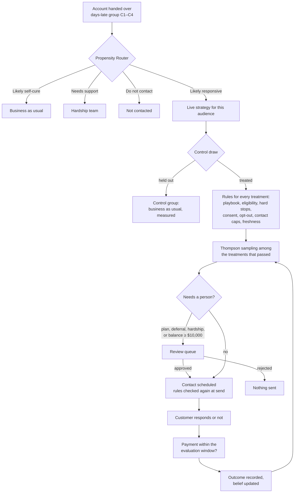
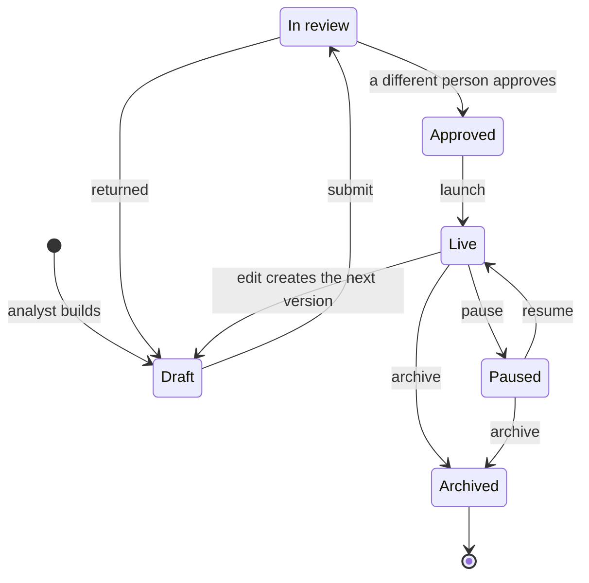
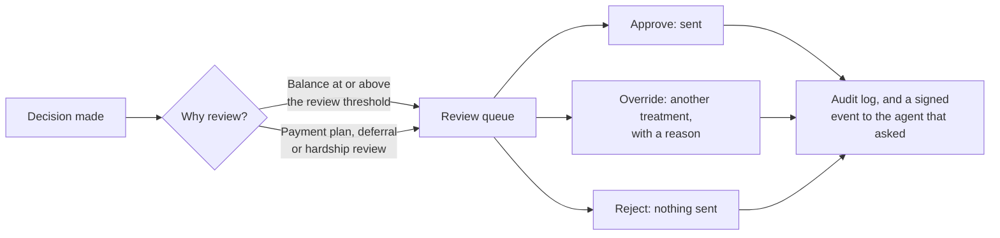
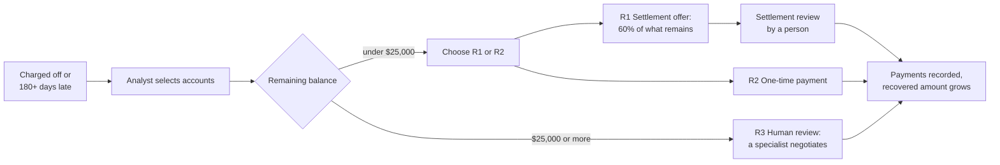
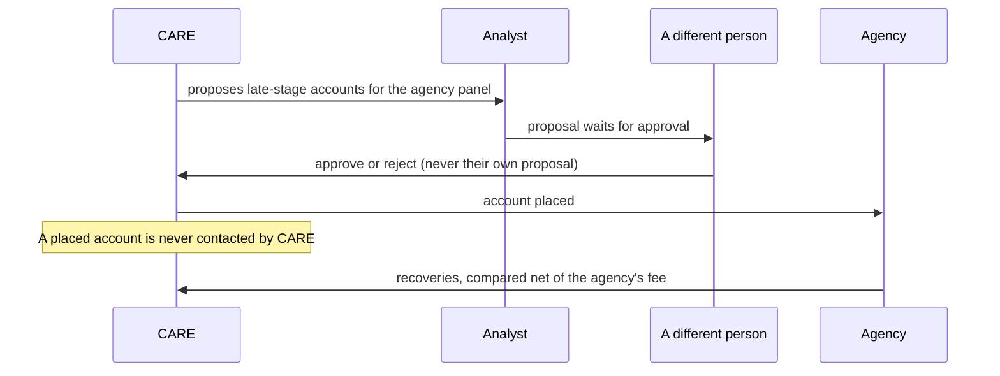
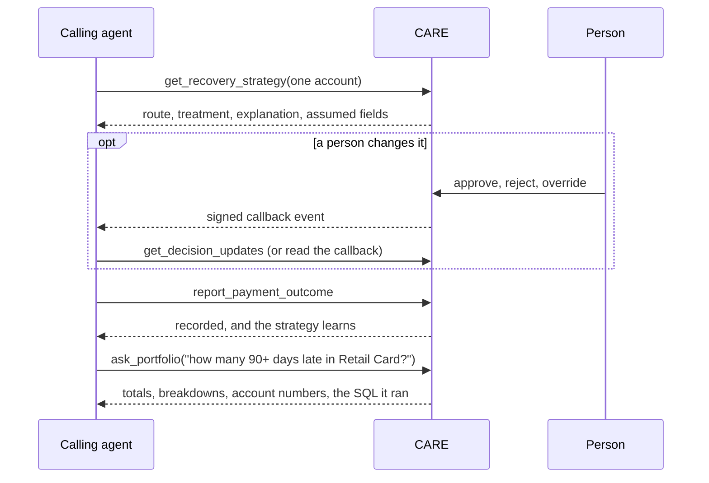

# CARE product guide

How CARE (Collection and Recovery Agent) works, who uses it, what each page is for, and how the main
flows run from start to finish. Written for business users, new team members and partner teams.

Related documents: [prd.md](prd.md) (what CARE must do and why) and [data-schema.md](data-schema.md)
(how its data is organised).

---

## 1. What CARE is, in one minute

Meridian Valley Bank already has a collections system. It knows which accounts are late, how late,
and how risky. What it does not know is **what to do next for each customer**: a reminder, an app
nudge, a payment plan, a call, or nothing at all.

CARE answers that question, one customer at a time:

1. **It routes.** Some customers will pay anyway. Some need hardship support. Some should not be
   contacted. Only the customers a message can help go into a strategy.
2. **It checks the rules first.** Consent, opt-outs, legal restrictions and the 7-in-7 contact cap
   remove anything the customer may not receive.
3. **It chooses.** Among the treatments that are left, Thompson sampling picks the one most likely to
   work for this customer, while still trying the others enough to keep learning.
4. **It proves the result.** Every strategy keeps a random control group, so CARE can show what the
   strategy *caused*, not just what was collected.
5. **A person stays in charge.** Strategies need a second person to approve them. Payment plans,
   deferrals, hardship reviews, settlements and large balances wait for a person before anything goes
   out.

CARE does not compute delinquency risk. The bank's risk band and score arrive with the account and
are shown as the bank's data.

---

## 2. Who uses it

CARE has three workspaces. Each person sees only the pages and data their role allows; the API enforces
this on every request.

| Role | Persona in the demo | What they do |
| --- | --- | --- |
| **Strategy analyst** | Morgan Ellsworth, Ryan Holcomb | Builds strategies, runs them in waves, watches results, works the review queue, assigns recovery treatments |
| **Executive** | Jordan Whitcomb | Approves strategies, compares them, sends improvement ideas to analysts, approves agency placements, watches compliance |
| **Platform admin** | Patricia Vaughn | Manages users, roles, settings, integrations, agent access and system health. **Never sees customer data** |

**Signing in.** Choose a persona on the sign-in page (a stand-in for single sign-on). Switch persona or
sign out from the user menu, top right.

**Finding things.** Press `/` or Ctrl+K anywhere to search pages, strategies, customers, decisions and
messages. Results only include what your role may open.

---

## 3. The pages

### Strategy analyst

| Section | Page | What it is for |
| --- | --- | --- |
| Overview | **Dashboard** | The day at a glance: accounts by book, where they went, what is collected and recovered by week, payment rate against control, strategies off track, items that need attention, and ideas from your executive |
| Accounts | **Customers** | Every account. Ask a question in plain English ("30 days late with a balance over $2,000 in Retail Card"), see the conditions it ran, and turn the result into a strategy's audience |
| | **Journeys** | Every customer a strategy has touched, and where their journey stands. Open one for its timeline: decisions, messages, replies, payments and the bank's own contacts |
| | **Cohorts and handoffs** | Where CARE starts: the accounts the collections system hands over, by days-late group |
| Strategy workspace | **Strategy workspace** | Collections and recovery by card business. Collections shows the live strategies; Recovery is where you select charged-off accounts and assign a recovery treatment |
| | **Collections journey** | The collections story from problem to result, told with the bank's own accounts. Has a Recovery tab |
| | **Strategy builder** | Create a strategy: from a suggestion, from the library, step by step (audience, treatments, review and submit), or from a short brief |
| | **My strategies** | Every strategy with its lifecycle state and its result against control |
| | **Treatment playbook** | The approved actions CARE may take, with eligibility, channel, cost and approval policy |
| Analysis | **Strategy analytics** | How every strategy is doing against its own control group, and what Thompson sampling has learned in each |
| | **Scorecards** | Is the router putting customers in the right groups, and is Thompson sampling picking well |
| | **Decisions** | The decision log. Open a decision for its full trace: route, rules, draws, review and send, and the data it was made on |
| Execution | **Live campaigns** | Running strategies: decide the next wave, watch the comparison with control build up |
| | **Live run** | Follow one customer through the engine step by step: pick, send, reply, learn |
| | **Review queue** | Decisions waiting for a person: large balances and forbearance offers |
| | **Collection agencies** | Late-stage accounts proposed to or placed with the bank's agencies, and what each agency recovers net of fees |
| | **Nudges** | Every message and call CARE scheduled, and what happened to it |
| | **Activity** | A live feed of what the engine decided, sent and recovered |

### Executive

| Section | Page | What it is for |
| --- | --- | --- |
| Overview | **Dashboard**, **Portfolio health** | The portfolio and the pipeline: where every handed-over account stands |
| Accounts | **Customers**, **Decisions** | As above |
| Strategy workspace | **Approvals** | Strategies submitted by analysts, waiting for sign-off |
| | **Strategy compare** | Up to three strategies side by side on uplift, recovery trend and cost per recovery |
| | **Strategy workbench** | Find what is underperforming, draft an improvement and send it to the strategy's owner |
| | Strategy workspace, Collections journey, Treatment playbook | As above |
| Analysis | **Team performance** | Analysts, their strategies and what those strategies caused |
| | **Reports** | CSV exports for model risk, compliance and management reporting |
| | Strategy analytics, Scorecards | As above |
| Execution | **Collection agencies** | Approve or reject placements proposed by others |
| | **Compliance** | Policy breaches across everything the customer experienced, CARE's and the bank's |
| | **Security and governance** | Encryption, tokenisation, fairness checks, where a person decides, traceability and retention |

### Platform admin

| Section | Page | What it is for |
| --- | --- | --- |
| Overview | **Admin dashboard** | Users, activity and platform status |
| | **User management** | Invite, activate, deactivate and change the role of users |
| | **Roles and permissions** | Grant or deny each permission to each role. Data permissions can never be given to the admin role |
| Configuration | **Platform configuration** | Review threshold, contact caps, contact hours, wave size, evaluation window, validation share, data freshness limits |
| | **API and integrations** | Agent access (MCP): the token, connection snippets, a live "try it" for sending an account and for asking questions, recent calls, and the signed callbacks sent to agents |
| | **Audit log** | Every user and system action, in order. Read-only |
| | **Security and governance** | As above |
| Monitor | **System health** | Latency and errors measured from live requests |
| | **Observability** | Traces, metrics, events and logs from the decision engine |
| | **Alert rules** | Thresholds evaluated against live metrics; firing alerts appear on the executive dashboard |

---

## 4. The main flows

### 4.1 From account to outcome

The core loop. Every decision, whether made in a wave, by Live run or by an outside agent, follows the
same path.

What to know:
- **The router comes first.** It keeps costly treatments away from customers who would pay anyway,
  and sends customers in hardship to people, not messages. 5% of two groups go against their route
  so the router itself can be scored on the Scorecards page.
- **Rules come before learning.** A treatment that fails any rule cannot be chosen. Each block is
  stored with a reason code, and the same rules run again when the message is sent.
- **Every decision is explained.** The decision page shows the route, every rule result, every draw,
  the winner and runner-up, the review, and the frozen data the decision was made on.
- **Overrides teach nothing.** If a person changes a decision, they give a reason, and the model does
  not learn from that customer.

### 4.2 Strategy lifecycle

1. **Build** in the Strategy builder. Pick the audience (a days-late group, card business, balance
   range, or a saved plain-English question), the treatments it may use, the control share and the
   wave size.
2. **Submit.** It moves to *In review* and appears on the executive's Approvals page.
3. **Approve.** Someone other than the author must approve it (maker-checker).
4. **Launch** and run **waves** from Live campaigns. Each wave decides the next set of customers;
   allocation follows what the previous waves taught.
5. **Watch** the strategy page: treated against control by week, uplift with its 95% interval, each
   treatment's belief narrowing wave by wave, and the per-treatment results.
6. **Change** it. A strategy that has run is never edited in place: *Edit* opens the next version as
   a draft. The running version keeps going until the new one is approved and launched; at that
   moment the old version is archived. Each version has its own control group.
   An approver who returns a strategy must say what needs to change.
7. **Archive** when done. Nothing with history is deleted.

### 4.3 Human review

The review threshold ($10,000 by default) is set by the admin in Platform configuration.

### 4.4 Recovery: charged-off accounts

Accounts that are charged off, or 180 or more days past due, leave collections and move to
**Recovery** (Strategy workspace → Recovery tab). They are tracked by what remains of the charged-off
balance.

10% of recovery accounts are held back at random so each recovery treatment is measured against no
contact.

### 4.5 Agency placement

### 4.6 Ideas from the executive

1. The executive opens the **Strategy workbench**, which lists strategies that are below target or
   showing no lift over control.
2. They draft an improvement (for example, add a payment plan to a strategy where one is missing) and
   send it to the strategy's owner.
3. The analyst sees it on their Dashboard under *Insights from your executive* and decides whether to
   apply it as a new version.

### 4.7 Asking questions in plain English

On **Customers**, type a question such as *"customers 60 days late in Co-Brand Card with a balance over
$3,000"*. CARE:
- reads it with fixed rules (no guessing), using only allowed fields;
- shows the conditions it understood, and lists any words it could not read;
- returns the matching accounts and totals;
- lets you save the result as a strategy's target audience.

The same questions are available to outside agents through the `ask_portfolio` tool (section 4.9).
Agents get account numbers, never names.

### 4.8 Live run: one customer, step by step

**Execution → Live run** follows one real customer through a live strategy, using the same engine and
storing the result, so the run then shows up in the customer's journey, the decision log and the
strategy's learning.

1. Pick a customer.
2. See the treatments weighed: which passed the rules, each draw, explore or exploit.
3. Send.
4. The customer responds.
5. Record the outcome.
6. See the belief update.

Two scenarios: *pays on the first message*, and *no answer, then a second try*, where the engine sets
the first treatment aside for that customer and picks again.

### 4.9 Outside agents (MCP)

CARE is also an MCP server, so another system's agent can use it without the console. An admin
manages access under **API and integrations**.

| Tool | Use |
| --- | --- |
| `get_recovery_strategy`, `get_recovery_strategies` | Decide and record the action for one account, or up to 100 |
| `preview_recovery_strategy` | The same answer without recording anything |
| `report_payment_outcome` | Report a payment so CARE learns |
| `get_decision`, `get_decision_updates` | A decision's current state, and the ones a person changed |
| `list_live_strategies`, `list_treatments` | What CARE is running and what it can choose from |
| `ask_portfolio` | A plain-English question about the accounts |
| `get_taxonomy`, `search_graph`, `get_node`, `traverse_graph`, `count_by`, `how_connected` | Explore the recovery knowledge graph |

Every call needs the bearer token and is written to the audit log.

### 4.10 Admin tasks

| Task | Where |
| --- | --- |
| Invite a user, change their role, deactivate them | User management |
| Grant or deny a permission for a role | Roles and permissions |
| Change the review threshold, contact cap, contact hours or wave size | Platform configuration |
| Reveal, copy or rotate the agent token | API and integrations |
| Check who did what | Audit log |
| Investigate a slow or failed decision | System health, Observability |
| Add or change an alert | Alert rules |

---

## 5. Reading the numbers

- **Uplift** is the treated payment rate minus the control payment rate for the same strategy. It is
  what the strategy caused.
- **95% interval.** If it crosses zero, the effect is not proven yet. The screens also show the
  smallest effect the current sample can detect.
- **Raw per-treatment rates are confounded.** The engine sends different customers to different
  treatments, so the strategy page also shows rates reweighted by the logged selection probability.
- **Belief** is Thompson sampling's current estimate of a treatment's payment rate in a strategy, with
  a band that narrows as outcomes arrive.

---

## 6. Glossary

| Term | Meaning |
| --- | --- |
| Days-late group | C1 1–29, C2 30, C3 60, C4 90+ days late |
| Fit group | The router's view of a customer: likely responsive, likely self-cure, needs support, do not contact |
| Treatment | An approved action in the playbook, such as S1 Reminder SMS or S3 Split payment plan |
| Strategy | A business-authored experiment: an audience, the treatments it may use, a control share |
| Wave | One batch of decisions within a live strategy |
| Control group | Customers in a strategy's audience held out at random and left on business as usual |
| Thompson sampling | The method that picks a treatment by drawing from each treatment's belief, so good treatments are used more while the rest are still tried |
| Review threshold | The balance at or above which a person approves every decision before it is sent |
| 7-in-7 | At most seven contacts per customer in seven days, across CARE and the bank's own systems |
| Recovery | Work on charged-off accounts, measured by what remains of the charged-off balance |
| Nova | The bank's data layer. CARE's source of customer and account data |
| MCP | Model Context Protocol: how outside agents call CARE |

---

## 7. What is simulated today

Customer behaviour and channel delivery are simulated. No channel gateway is connected, so decisions
are made and logged and no customer is contacted. All customer data is synthetic.
